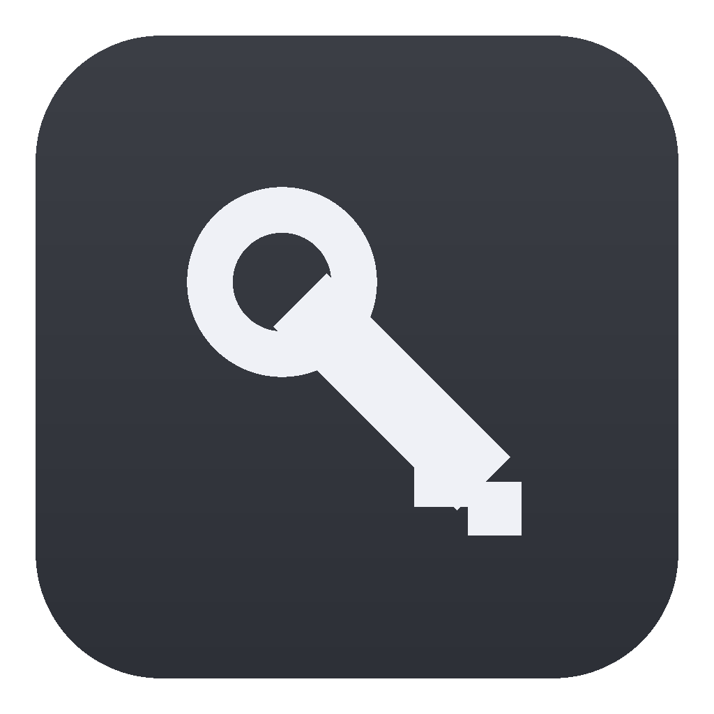
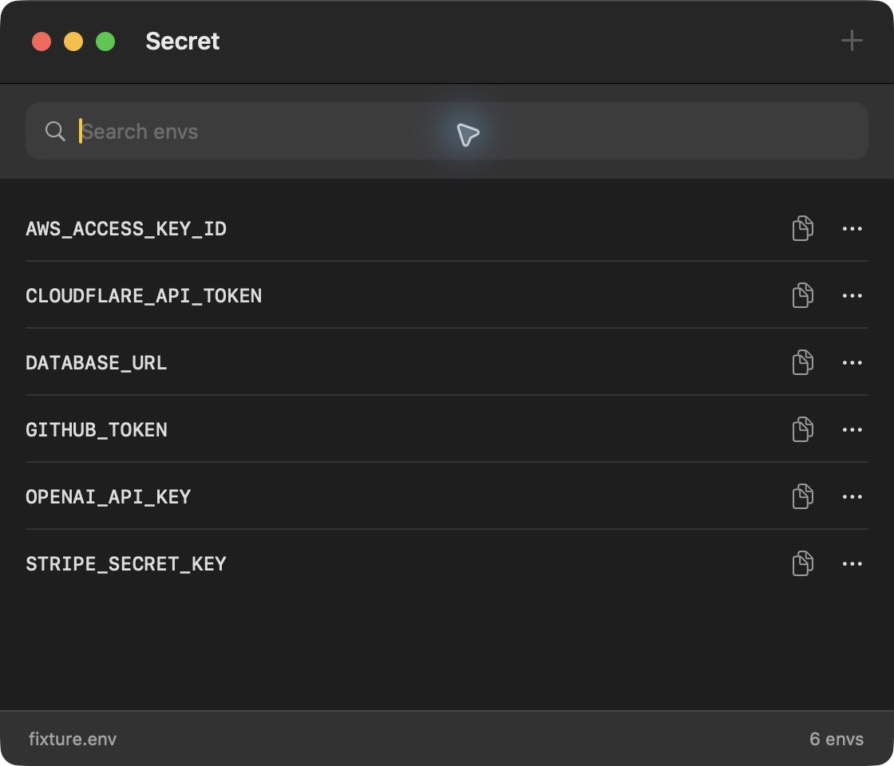

<div align="center">
  
  <h1>Secret</h1>
  <p>A small native Mac app for your envs.</p>
  <p><a href="https://github.com/jschof1/secret-mac/releases/latest/download/Secret.dmg"><strong>Download for Mac</strong></a> · <a href="https://github.com/jschof1/secret-mac/releases/latest">All downloads</a></p>
  <p>macOS 14+ · Apple Silicon and Intel · MIT licence</p>
</div>

<p align="center"></p>

## Install

1. Download [Secret.dmg](https://github.com/jschof1/secret-mac/releases/latest/download/Secret.dmg).
2. Drag **Secret** into **Applications**.
3. Open **Secret**.

No Python, developer tools, account or preinstalled helper is required. The app includes its native helper.

**This release is not Developer ID signed or Apple-notarised.** After attempting to open it, macOS may require approval in **System Settings → Privacy & Security → Open Anyway**. Use a copy from this repository's [official releases](https://github.com/jschof1/secret-mac/releases). Apple describes this process in [Open apps safely on your Mac](https://support.apple.com/102445).

Prefer a ZIP? Download [Secret.zip](https://github.com/jschof1/secret-mac/releases/latest/download/Secret.zip). [SHA256 checksums](https://github.com/jschof1/secret-mac/releases/latest/download/SHA256SUMS.txt) cover every download.

## Use

Search an env name and click its copy button. Press **⌘N** to add one. Use the row menu to edit or reveal it.

| Shortcut | Action |
| --- | --- |
| ⌘F | Search |
| ⌘N | New env |
| Return in search | Copy the first match |
| ⇧⌘C | Copy the selected or first matching env |
| ⌘E | Edit the selected env |
| ⌘R | Reload |
| Esc | Close the form or hide a value |

Secret reads your existing `~/.env`. If it does not exist, your first save creates it with private permissions. It preserves unrelated entries and makes a private backup before each changed save.

Values and backups are **plaintext local files**. There is no encryption, Keychain storage, cloud sync or credential upload. The app does not change shell startup files or inject envs into running processes. See [Local data](docs/data.md) for the exact storage and clipboard behaviour.

The [command-line tool](docs/cli.md) is optional. The app works without installing it.

## Build and contribute

Building from source requires Xcode Command Line Tools. Downloading the app does not.

```sh
git clone https://github.com/jschof1/secret-mac.git
cd secret-mac
./scripts/build.sh
```

The universal app is written to `build/Secret.app`. To install the app and CLI from that build, use `./scripts/install.sh --skip-build`. Existing copies are backed up first. No credentials change during installation.

See [Development and releases](docs/development.md) for fixture tests, packaging and release steps. Bug reports should use dummy values. For security issues, use [private reporting](https://github.com/jschof1/secret-mac/security/advisories/new).

[MIT licence](LICENSE) · [Changelog](CHANGELOG.md) · [Releases](https://github.com/jschof1/secret-mac/releases)
